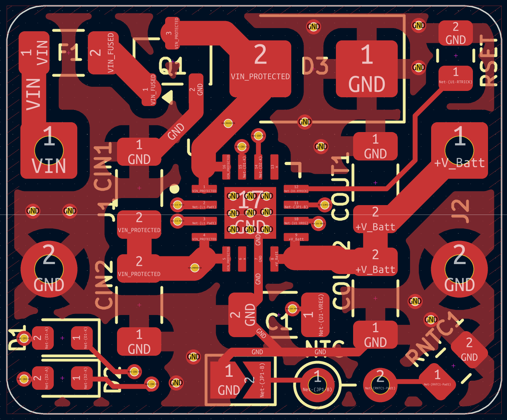
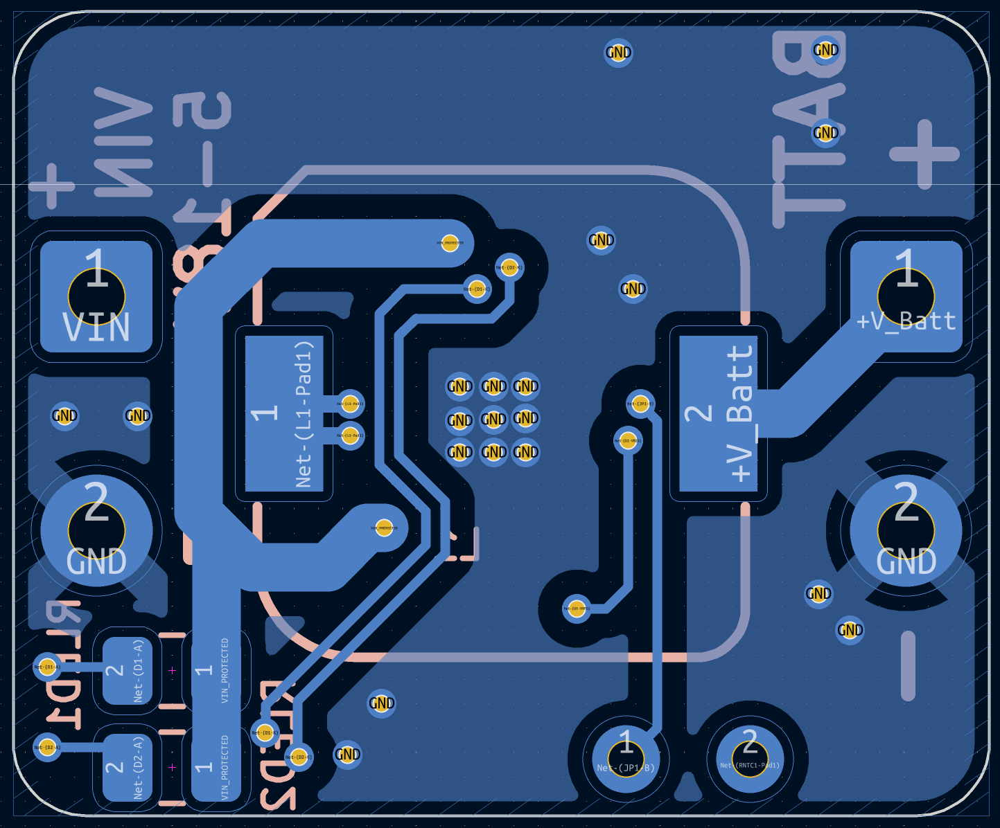

# TP5100 Micro Li-Ion Battery Charging Module (V2 — Micro Redesign)

[](https://www.kicad.org/)
[](#)
[](#)

An ultra-compact, high-efficiency lithium-ion battery charging module based on the **TP5100** synchronous buck switching controller, designed in KiCad with full schematic, layer plots, and 3D photorealistic visualization.

> [!NOTE]
> **Project Context (V2 Micro Redesign)**  
> This board represents the **Micro Module redesign (August 2026)** of the author's original TP5100 charging board. It achieves an aggressive **66% reduction in surface area** (down to just 20.0 mm × 16.5 mm) compared to the original [**TP5100 1S Learning Design (V1)**](https://github.com/koko69420/TP5100-1S-Charger), while adding selectable 1S (4.2V) or 2S (8.4V) cell configuration, rounded corner edge cuts, and high-density double-sided SMD placement.

---

## 3D Renders

| Top View | Bottom View |
| :---: | :---: |
|  |  |

---

## Evolution & Version Comparison

| Parameter | [V1: KiCad Learning Board](https://github.com/koko69420/TP5100-1S-Charger) | V2: Micro Module Redesign (This Repo) |
| :--- | :--- | :--- |
| **Role & Context** | Initial design created to learn KiCad | Ultra-compact miniaturized redesign |
| **Board Dimensions** | 55.5 mm × 17.6 mm (977 mm²) | **20.0 mm × 16.5 mm** (330 mm²) — *66% smaller* |
| **Edge Geometry** | Standard rectangular (90° corners) | **Rounded corner arcs** |
| **Battery Topology** | 1S dedicated (4.2V) | **1S (4.2V) / 2S (8.4V) selectable** via solder jumper |
| **Max Charge Current** | Up to 2.0 A | Up to 2.0 A |
| **Input Supply** | 5.0 V – 18.0 V DC | 5.0 V – 18.0 V DC |
| **Component Density** | Spacious layout for hand assembly | **High-density double-sided SMD** layout |
| **Thermal Strategy** | Distributed copper pours | **Thermal relief via stitching under IC** |

---

## Features

- **Ultra-Compact Micro Form Factor**:
  - Footprint reduced to only 20.0 mm × 16.5 mm with rounded corners, suitable for embedding inside tight handheld enclosures, RC models, and modular battery packs.
- **Selectable 1S / 2S Charging**:
  - Configurable for 1-cell (4.2V) or 2-cell series (8.4V) lithium-ion / lithium-polymer chemistry via onboard solder jumper.
- **Synchronous Buck Switching Architecture**:
  - High switching frequency (~400 kHz) allows use of small surface-mount power inductors while maintaining cool operation at up to 2A charge current.
  - Multi-stage Constant Current (CC) / Constant Voltage (CV) charging with trickle pre-charging for over-discharged cells.
- **Wide Input Supply Range**:
  - 5V to 18V DC input capability, compatible with USB supplies, 12V DC power adapters, and small solar panels.
- **Dual Status Indication & Telemetry**:
  - Onboard dual LED indicators for active charging state and charge completion / battery standby.
- **Comprehensive Visual Documentation**:
  - Multi-layer vector assembly plots (`pcb.pdf`, `TP5100_Charging_Module-F_Cu.pdf`, `TP5100_Charging_Module-B_Cu.pdf`).
  - High-resolution schematic diagrams (`Schematic.pdf`, `Schematic.png`).
  - Front and back photorealistic 3D board renders (`Front.png`, `Back.png`).

---

## Hardware Specification

| Parameter | Specification | Details |
| :--- | :--- | :--- |
| **Controller IC** | TP5100 | Synchronous Step-Down Lithium Battery Charger |
| **Input Supply** | 5.0 V – 18.0 V DC | DC barrel jacks, USB-C 5V–12V PD, solar panels |
| **Output Voltage** | 4.2V (1S) / 8.4V (2S)| Solder-jumper selectable |
| **Max Charge Current**| 2.0 A | Current programming resistor dependent |
| **Switching Freq** | ~400 kHz | High-frequency operation for miniature power inductors |
| **Board Dimensions** | 20.0 mm × 16.5 mm | Double-sided 2-layer FR4 with rounded corners |

---

## Project Structure

```text
TP5100-Charging-Module/
├── Front.png                         # 3D PCB top surface render
├── Back.png                          # 3D PCB bottom surface render
├── Schematic.pdf                     # High-resolution vector schematic
├── Schematic.png                     # Raster schematic preview
├── pcb.pdf                           # Complete board outline and trace plots
├── TP5100_Charging_Module.kicad_sch  # KiCad schematic design file
├── TP5100_Charging_Module.kicad_pcb  # KiCad PCB board layout
├── TP5100_Charging_Module.kicad_pro  # KiCad project file
├── TP5100_Charging_Module-F_Cu.pdf   # Front copper layer plot
├── TP5100_Charging_Module-B_Cu.pdf   # Back copper layer plot
├── .gitignore                        # Git ignore patterns
└── README.md                         # Project documentation
```

---

## License

Open hardware design. All rights reserved by Kausthubh Viswanath.
